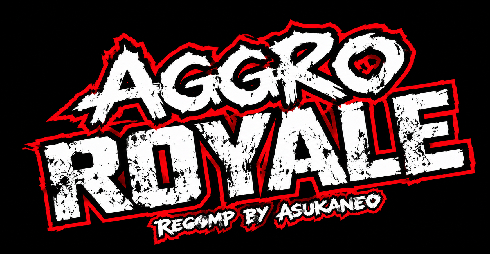
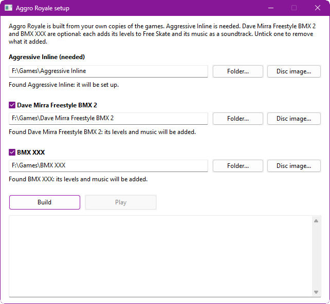
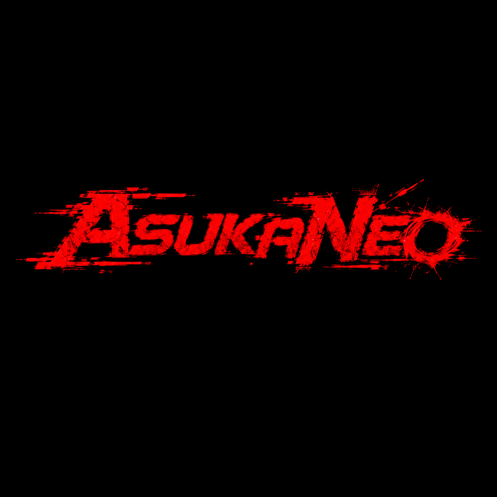

<p align="center">
  
</p>

<p align="center">
  <b>A recompilation of <i>Aggressive Inline</i> for the original Xbox, running natively on Windows.</b>
</p>

<p align="center">
  
  
  
  
</p>

> [!NOTE]
> **Beta.** The game plays from start to finish on the GPU renderer. Expect rough edges, especially in the optional added levels, and please [report problems](https://github.com/AsukaNeo/aggro-royale/issues).

## About

*Aggressive Inline* (2002) is Z-Axis's inline skating game. **Aggro Royale** turns its Xbox code into C and compiles it for a modern PC, so it runs natively, without an emulator, with modern conveniences on top. If you also own *Dave Mirra Freestyle BMX 2* or *BMX XXX*, their levels and music can join the game too. Bring your own copies: nothing from any game is included here.

## New levels, for the first time since 2002

For the first time since 2002, you can play **new levels** in *Aggressive Inline*. Give the setup your own disc images of *BMX XXX* and *Dave Mirra Freestyle BMX 2*, and it builds a **plus version** of *Aggressive Inline*: their maps join Free Skate, and their songs join the game's soundtrack, as bonus features.

- **18 bonus levels in Free Skate**: 10 from *Dave Mirra Freestyle BMX 2* (Woodward, Airport, Cloverleaf, Commercial, Devils Peak, Galloon, Greenville, Swamp Trail, Train Yard, Venice Beach) and 8 from *BMX XXX* (Rampage Park, The Dam, Mnco, Mullaly, Launch Pad, Sheep Farm, Syracuse, Root)
- **38 bonus songs**: both games' soundtracks, each as its own soundtrack in the music menu
- Either game on its own works too, and the setup can take its extras out again

> [!WARNING]
> **The bonus features are a beta.** These levels were never designed for *Aggressive Inline*. They work because all three games share Z-Axis's engine, and they are still a lot of fun to skate around, but expect rough spots: grinds feel a little different, a few places let you fall out of the level, and there are no challenges or characters on them.

## Status

- ✅ Career, challenges and Free Skate, menus, audio, controller with rumble, keyboard
- ✅ GPU renderer (Direct3D 11) in widescreen, with the render resolution adjustable while you play
- ✅ Optional frame generation up to your display's refresh rate (120 Hz and up)
- ✅ Everything unlocked from a fresh save (can be turned off), and saves kept next to the game
- ✅ Optional extras from your own copies: the levels of *Dave Mirra Freestyle BMX 2* (10) and *BMX XXX* (8) in Free Skate, and both games' soundtracks
- 🚧 Added levels are free roam only (no challenges or characters), grinds feel slightly different, and a few spots let you fall out of the level
- 🚧 Some effects are not right yet: the level-up glow, blood from falls
- ⛔ No online play, and none planned

## What you need

- *Aggressive Inline* for the original Xbox, **North American release** (version 1), as a disc image (`.iso`) or its files (`default.xbe` and the `media` folder)
- Optional: *Dave Mirra Freestyle BMX 2* and/or *BMX XXX* for the original Xbox (North American), the same way
- Windows 10 or 11, 64-bit, and a graphics card with Direct3D 11

## Setting it up

Run **`aggro_setup.exe`**, next to `aggro_royale.exe`. It finds game copies next to itself; otherwise choose each one's folder or disc image.

<p align="center">
  
</p>

- **Aggressive Inline** is needed. Its release is checked before anything is copied; a disc image is unpacked into a `game` folder, a folder is used where it is.
- **Dave Mirra Freestyle BMX 2** and **BMX XXX** are optional. Tick one and its levels are converted for Free Skate and its music becomes a soundtrack, built into `mods` from your copy. Untick it and run the setup again to remove what it added.

Then press **Play**, or start `aggro_royale.exe`. Scripts can do the same: `aggro_setup --build --ai <game> --dm2 <game> --xxx <game>` (`--no-dm2` or `--no-xxx` removes one).

## Build it yourself

You need [Build Tools for Visual Studio 2022](https://visualstudio.microsoft.com/downloads/#build-tools-for-visual-studio-2022) with **Desktop development with C++**, [Python 3.8+](https://www.python.org/downloads/) and [Git for Windows](https://git-scm.com/download/win).

1. Clone this repository, and next to it the toolkit at its supported version, with this project's patch:
   ```bash
   git clone --branch v0.16.0 https://github.com/sp00nznet/xboxrecomp.git
   cd xboxrecomp && git apply ../aggro-royale/patches/xboxrecomp-local.patch
   ```
2. Put your game in `aggro-royale/game` (`default.xbe` and its `media` folder).
3. In Git Bash, in `aggro-royale`: `./lift.sh` turns the game's code into C in `src/recomp/gen/`. It is made from your copy and never committed.
4. `cmake -S . -B build -A x64`, then `cmake --build build --config Release`.
5. Run `build/Release/aggro_setup.exe`, then `build/Release/aggro_royale.exe`.

`run.sh <name>` runs a build with its log in `<name>.log` and sums up crashes and missing functions. The level conversion has a Python twin for working on the formats, `tools/zaxis_port.py` and `tools/build_level_menu.py`; the setup writes the same files byte for byte.

## Controls

Any Xbox-style controller works and plays as player 1. On the keyboard: **Enter** = Start, **Z X C V** = A B X Y, **WASD** to move, **arrow keys** for the d-pad.

| Key | Action |
|---|---|
| F10, or Back+Start | Settings overlay |
| Alt+Enter or F11 | Fullscreen |
| F12 | Screenshot |

Settings live in `aggroroyale.ini` next to the exe; the overlay writes it for you.

## Mods

Each folder in `mods` is laid over the game's files: a file at `mods/<name>/media/...` replaces the game's file at the same path. Folders are applied in name order, and a folder whose name starts with `_` is skipped. A `soundtrack.txt` in a mod adds its songs as a soundtrack, and a `levels.txt` adds levels to Free Skate; `aggro_setup` writes both kinds for the BMX games.

## Credits

- **[xboxrecomp](https://github.com/sp00nznet/xboxrecomp)** by sp00nz and contributors, the base this project is built on
- **[xemu](https://github.com/xemu-project/xemu)**, the reference for Xbox hardware behaviour (see [NOTICE](NOTICE))
- **[Exonerated](https://github.com/AsukaNeo/Exonerated)**, the *Deathrow* port this one follows
- A professional coder's input throughout

## AI assistance

AI (**Claude Opus 5.5**) was used as a development assistant for the intensely time-consuming recompilation work, to make this project a reality sooner. Human-made decompilation projects are the gold standard. View the use of AI in this project in whatever way feels most appropriate to you.

## Legal

MIT licence (see [LICENSE](LICENSE) and [NOTICE](NOTICE)), covering this project's own code only. Aggro Royale is an independent fan project, not affiliated with the rights holders of *Aggressive Inline*, *Dave Mirra Freestyle BMX 2* or *BMX XXX*, or with Microsoft. Those games, their music, Xbox and related marks belong to their owners. No game code, data, music or assets are included: the program and its setup work only from your own copies.

<p align="center">
  
</p>
